

<picture><source media="(prefers-color-scheme: dark)" srcset="assets/hero-dark.svg"></picture>

<picture><source media="(prefers-color-scheme: dark)" srcset="assets/social-l-dark.svg"></picture><a href="https://YouTube.com/@circledevelop"><picture><source media="(prefers-color-scheme: dark)" srcset="assets/social-1-dark.svg"></picture></a><a href="https://instagram.com/@circledevelop1"><picture><source media="(prefers-color-scheme: dark)" srcset="assets/social-2-dark.svg"></picture></a><picture><source media="(prefers-color-scheme: dark)" srcset="assets/social-r-dark.svg"></picture>

<picture><source media="(prefers-color-scheme: dark)" srcset="assets/about-dark.svg"></picture>

<picture><source media="(prefers-color-scheme: dark)" srcset="assets/stack-dark.svg"></picture>

<a href="https://github.com/BunglonMewing/Zoya"><picture><source media="(prefers-color-scheme: dark)" srcset="assets/project-zoya-dark.svg"></picture></a>&nbsp;<a href="https://github.com/BunglonMewing/RaVin-Store"><picture><source media="(prefers-color-scheme: dark)" srcset="assets/project-ravin-store-dark.svg"></picture></a>

<a href="https://github.com/BunglonMewing/grabr"><picture><source media="(prefers-color-scheme: dark)" srcset="assets/project-grabr-dark.svg"></picture></a>&nbsp;<a href="https://github.com/BunglonMewing/Notes"><picture><source media="(prefers-color-scheme: dark)" srcset="assets/project-notes-dark.svg"></picture></a>

<picture><source media="(prefers-color-scheme: dark)" srcset="assets/stats-dark.svg"></picture>

<picture><source media="(prefers-color-scheme: dark)" srcset="assets/streak-dark.svg"></picture>

<picture><source media="(prefers-color-scheme: dark)" srcset="assets/wave-dark.svg"></picture>

<a href="https://metawka.github.io/expressive-profile/?from=BunglonMewing"><picture><source media="(prefers-color-scheme: dark)" srcset="assets/credit-dark.svg"></picture></a>

